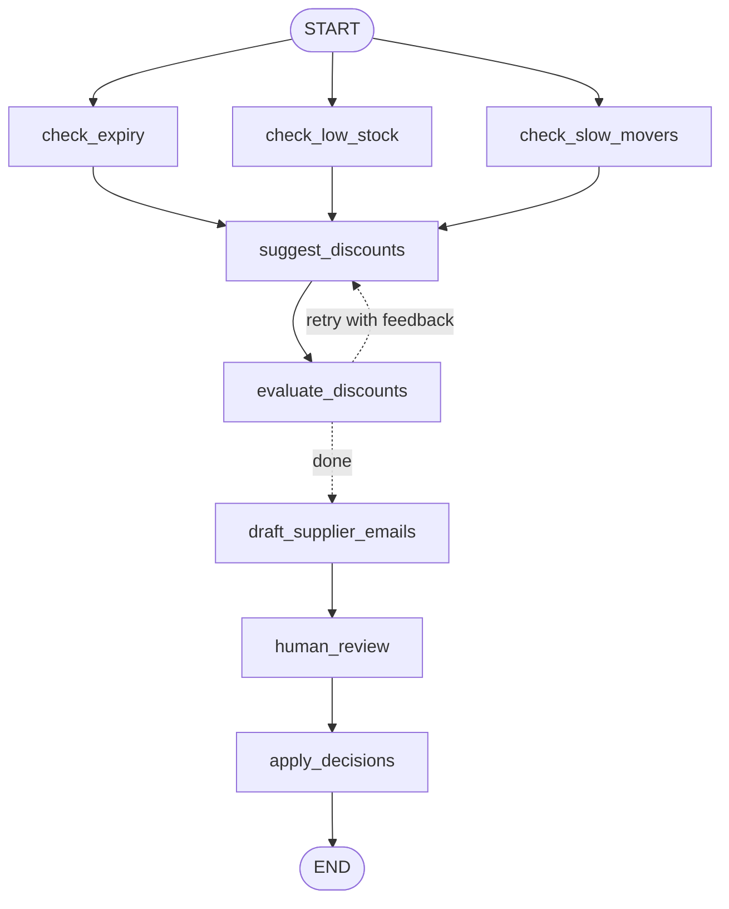

# Inventory Management Using Agentic AI

An agentic system for a small supermarket, built with **LangChain** and **LangGraph**.
It monitors expiry dates, suggests discounts, drafts supplier reorder emails (sent only
after the manager approves them), and answers the manager's inventory questions in a chat.

| Project requirement | How it is covered |
|---|---|
| Monitor product expiration dates | `check_expiry` node and `get_expiring_products` tool |
| Suggest discounts | `suggest_discounts` (LLM) + `evaluate_discounts` (Python rules) loop |
| Communicate with suppliers | `draft_supplier_emails` + `human_review` (manager approval with `interrupt()`) |
| Support inventory-related decisions | Chat agent (`agent.py`) built with `create_agent` and 4 database tools |

## Architecture

The project has two parts that share the same database and tools.

### 1. Daily workflow (LangGraph): `workflow.py`

A fixed business process that runs on its own:



| Node | What it does | Concept used |
|---|---|---|
| `check_expiry`, `check_low_stock`, `check_slow_movers` | Read the database at the same time | Parallelization |
| `suggest_discounts` | LLM proposes discounts as typed data (`DiscountPlan`) | Structured output |
| `evaluate_discounts` | Python checks every price: real product, below the current price, never below cost. Rejected suggestions go back to the LLM with feedback (max 3 attempts) | Evaluator-optimizer, conditional edges |
| `draft_supplier_emails` | Python calculates order quantities; the LLM only writes the emails | Structured output |
| `human_review` | Pauses the graph until the manager approves or rejects | `interrupt()`, checkpointer, `Command(resume=...)` |
| `apply_decisions` | If approved, "sends" the emails and publishes the discounts by saving them to `outbox/` | |

### 2. Decision-support chat agent (LangChain): `agent.py`

A `create_agent` agent with a system prompt, 4 tools, and an `InMemorySaver` checkpointer
(short-term memory, so follow-up questions like "what about milk?" work).

| Tool | Answers |
|---|---|
| `get_expiring_products(days)` | What is expired or expiring soon? |
| `get_low_stock_products()` | What must be reordered, and from which supplier? |
| `get_slow_moving_products(days, max_units_sold)` | What is not selling? |
| `get_product_details(product_name)` | Everything about one product |

### Data: `data/seed_db.py`

A generated SQLite database with 4 tables: `suppliers`, `products`, `batches` (each delivery
with its own expiry date) and `sales` (last 30 days). Dates are relative to the day the
script is run, so there is always something expiring during a demo.

## Design decisions

- **The LLM decides, Python guarantees.** Prompts ask the LLM never to price below cost, but
  a prompt is a request, not a guarantee. The `evaluate_discounts` node enforces the rule in
  code, so an unsafe price can never be approved.
- **Numbers come from code, not the LLM.** Order quantities are calculated in Python
  (enough to reach twice the reorder level); the LLM only writes the email text.
- **A human approves before anything leaves the system.** Emails are only "sent" after the
  manager approves them at `human_review`.
- **Expired stock is not discounted.** Batches already past their expiry date are reported
  for removal instead.

## Setup

Requires Python 3.10+ and a free Gemini API key from [Google AI Studio](https://aistudio.google.com).

```bash
git clone <this repo>
cd inventory-agent
python -m venv .venv
.venv\Scripts\Activate.ps1          # Windows PowerShell (macOS/Linux: source .venv/bin/activate)
pip install -r requirements.txt
```

Create a `.env` file in the project root:

```
GOOGLE_API_KEY=your-key-here
GEMINI_MODEL=gemini-2.5-flash
```

## How to run

```bash
python data/seed_db.py      # 1. create the sample database
python run_workflow.py      # 2. run the daily workflow (asks you to approve at the end)
python agent.py             # 3. chat with the inventory assistant
```

Test scripts that need no LLM: `python try_tools.py` (database tools) and
`python try_evaluator.py` (discount rules, with deliberately bad suggestions).

## Limitations and possible improvements

- Discounts apply to a whole product, not to a single batch.
- Emails are saved as files instead of being sent through a real email service.
- Memory is in RAM (`InMemorySaver`); a database checkpointer would keep it between runs.
- Not yet added: RAG over store policy documents, long-term memory of manager preferences,
  and a `RetryPolicy` on LLM nodes for temporary API errors (503).
